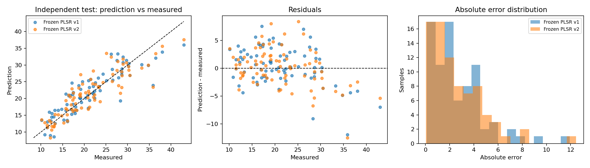

# 测试集独立评价报告

## 评价范围

本报告使用用户另行提供的测试集真实值，对此前保存并冻结的模型预测进行**独立测试集评价**。真实值工作簿为 `测试集的真实值.xlsx`，共 80 行，字段为“序号”和“化学成分含量”，没有光谱文件名列。本次按工作簿的整数序号与预测 CSV 文件名数字部分关联，并验证真实值 ID 与两版预测文件 ID 集合均为一一对应的 80 个样本；没有按行位置配对。源表及真实值未复制到仓库，也未写入本报告、汇总 JSON 或误差表。

评价前已存在的预测文件：首版 `results/test_predictions.csv`（SHA-256 `8309460f27b8edc0f47ea1fe367e603b8072041d3a304302ff312ee95d8be515`），优化版 `results_v2/test_predictions.csv`（SHA-256 `13bc3b3b9ddc628db69c55bf682fc9a83d606c11f858b894db73bbd01062f56b`）。用于评估的原始工作簿按用户明确授权与本次工作一并纳入**私有**仓库（SHA-256 `4826ad1aa47cfe012e9d2f08682a495dd9f167072ae301cc661ba786f3fc5d81`）；逐样本真值及逐样本误差未另外导出为 CSV 或报告。另报告冻结模型文件及建模代码的哈希用于追溯。此次只读取真实值、计算指标和生成诊断；没有以测试真值重训练、校准、调参、修改预测或选择模型。

## 独立测试指标

比赛定义为 `SEP = sqrt(sum((实际值 - 预测值)^2) / (n - 1))`（**不扣除残差偏差**），`MAE = mean(abs(实际值 - 预测值))`。

| 冻结预测 | 样本数 | SEP | MAE | 偏差（预测 − 实际） | R² | 绝对误差中位数 | 绝对误差 P90 | 低估/高估数 |
|---|---:|---:|---:|---:|---:|---:|---:|---:|
| 首版冻结 PLSR | 80 | 3.4506 | 2.6527 | 0.4107 | 0.7654 | 2.1835 | 5.1247 | 36/44 |
| 优化版冻结 PLSR | 80 | 3.4210 | 2.5987 | 0.1041 | 0.7694 | 1.9181 | 5.3237 | 38/42 |



图中散点及残差仅用于诊断，不包含逐条真实值导出。偏差的正值表示整体高估，负值表示整体低估。P90 为绝对误差的第 90 百分位。

优化版绝对误差最大值为 12.4604；优化版实测值范围为 10.1300–42.9700（原始表未给单位）。按此前探索报告中使用的实测值 30 作为事后诊断切点，优化版该区间包含 9 条样本，MAE 为 4.2512、偏差为 -4.2512；此切点不代表业务阈值，也未用于选模。

## 与校正集交叉验证区分

| 评估集 | 样本数 | 优化版 PLSR SEP | 优化版 PLSR MAE |
|---|---:|---:|---:|
| 校正集嵌套交叉验证折外预测 | 320 | 3.4672 | 2.5147 |
| 独立测试集冻结预测 | 80 | 3.4210 | 2.5987 |

这两行对应不同样本与评估设计，交叉验证值不是测试标签的一部分。独立测试结果可直接描述这 80 个配对样本；不要在看到它之后调整模型或用其筛选模型。

## 样本 bootstrap 区间与解释

对已冻结的 80 对样本按样本对进行 5000 次有放回重抽样（固定种子 20261115），得到如下 95% 百分位区间：

| 冻结预测 | SEP 95% 区间 | MAE 95% 区间 |
|---|---:|---:|
| 首版冻结 PLSR | [2.8101, 4.1273] | [2.1971, 3.1570] |
| 优化版冻结 PLSR | [2.7689, 4.1102] | [2.1402, 3.1044] |

这些区间反映当前 80 对已观测预测与实测的样本重抽样波动；不包括重新采集样本、训练、选模和潜在批次/样本相关结构带来的不确定性。
两个模型预测均在看到本次测试真值前冻结。本表比较属于对两个冻结模型的**事后比较**，不能据此再选出模型并声称该测试集仍提供了无偏的选模性能估计。配对 bootstrap 中“首版冻结 PLSR 减 优化版冻结 PLSR”SEP 差值的 95% 区间为 [-0.4564, 0.4549]，MAE 差值区间为 [-0.3722, 0.4484]；正值表示后一模型误差更低。

优化版的 SEP 和 MAE 在这批样本上略低于首版，但上述配对差值区间均跨过 0，因此不能据此认定优化版具有可靠优势。

测试集上的实测性能可作为这批独立样本的直接验证，但是否“可用”还需要化学成分名称/单位、业务验收阈值及样本代表性。测试集表现不替代未来批次或新仪器的外部验证。校正集的嵌套交叉验证结果仍见仓库中的[优化版模型报告](../模型优化评价报告.md)；不要把交叉验证值与本报告的独立测试值混为一谈。

## 复现及隐私

在仓库根目录执行：

```powershell
python evaluate_test.py --labels "D:\路径\测试集的真实值.xlsx"
python -m unittest discover -s tests
```

评估输出保存在被 Git 忽略的 `results_external/`：本报告、诊断图和只含汇总指标的 JSON。标签工作簿及逐样本实际值/残差不会写入输出。代码不修改预测文件。正式发布前请重新检查文件权限和数据授权；不要将真实值表、包含逐样本真值的图表或本地 `results_external/` 加入 Git。