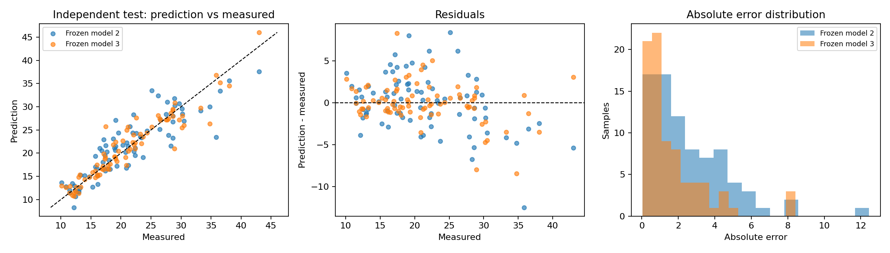

# 模型 3 测试集事后核对

> **重要：该测试集此前已用于模型 1/2 的评价，独立确认性用途已经消耗。**以下结果是在模型 3 和预测文件冻结后，对同一测试集做的探索性/事后核对；不能用于选模、调参或宣称模型 3 的独立无偏性能。

按“序号”与测试光谱文件名数字编号核验 80 个唯一样本的一一对应后，冻结模型 2/3 的预测评价如下。竞赛 SEP 为 `sqrt(SSE/(n-1))`，不扣偏差；MAE 为平均绝对误差。

| 已冻结模型 | 样本数 | SEP | MAE | 偏差（预测 − 实测） | R² | 最大绝对误差 |
|---|---:|---:|---:|---:|---:|---:|
| 模型 2（SNV-PLS） | 80 | 3.4210 | 2.5987 | 0.1041 | 0.7694 | 12.4604 |
| 模型 3（嵌套算法选择） | 80 | 2.4353 | 1.6469 | -0.0092 | 0.8831 | 8.4141 |

按 2000 次样本级配对 bootstrap，差值“模型 2 减模型 3”的 MAE 95% 区间为 [0.3905, 1.5413]，SEP 区间为 [0.1419, 1.8461]。正数表示模型 3 误差更低。该区间仅描述固定预测的重抽样变化，且属于已消耗测试集上的事后比较，不能作为确认性选模依据。

实测值不低于 30 的 9 条样本中，模型 3 的 MAE 为 3.5566，平均偏差为 -2.6758。此为事后描述切片，不是业务阈值或调参依据。

模型 3 的主要选择和性能估计仍以[校正集五折嵌套交叉验证报告](../模型3评价报告.md)为准。由于缺少化学成分单位、验收容差及未来批次验证，不能据本次事后测试核对断言可供实际放行使用。
