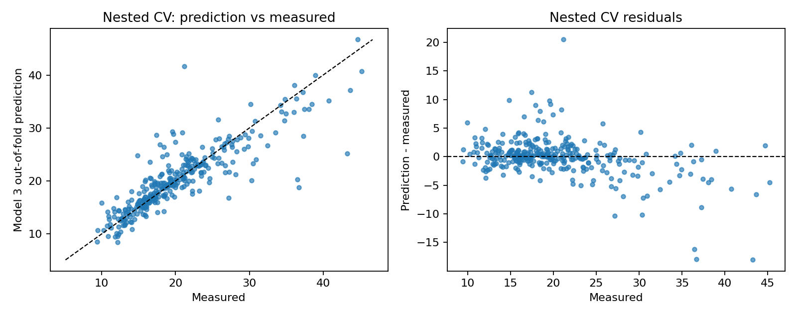
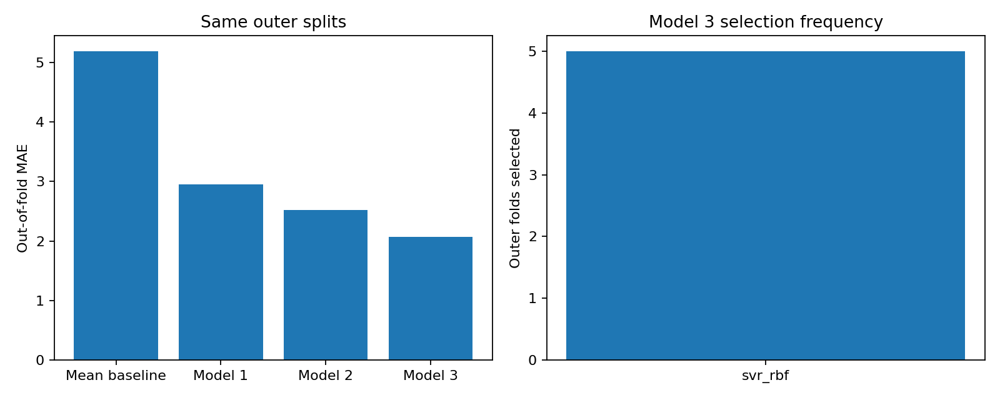
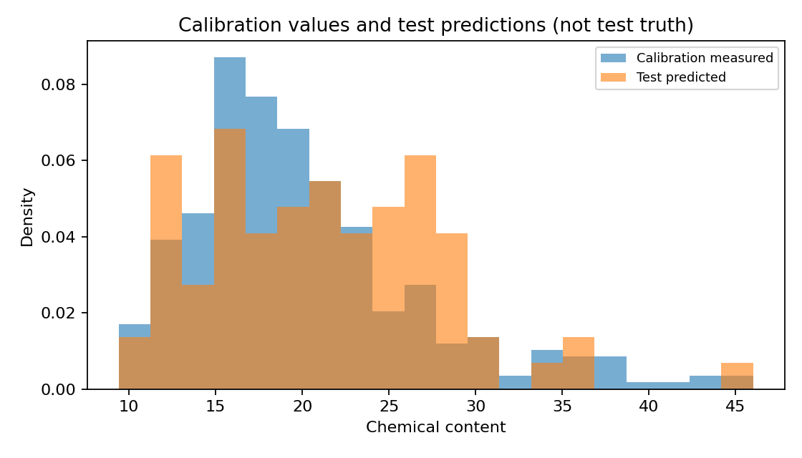

# 模型 3：NIR 嵌套算法选择与评价

## 结论

在 320 条校正样本上使用与模型 1/2 相同的五折外层划分，对预先限定的候选算法执行**严格嵌套选模**后，模型 3 的折外 SEP 为 **3.4515**、MAE 为 **2.0711**。模型 1、模型 2 和训练折均值基线在相同外层样本上的指标分别见下表。本结果是限定候选集合内模型选择流程的交叉验证估计，不是对所有可能算法的保证。

**独立测试集说明：**测试标签此前已用于模型 1/2 的评价，已经不再是模型 3 的确认性独立验证集。模型 3 的测试预测仅在其嵌套交叉验证和全量校正集选参完成、预测文件冻结后作事后核对；即使报告测试误差，也不得据此调参、选模或宣称无偏模型比较。

## 数据与模型设计

校正集 320 个样本、每个样本 2074 个波数变量；标签由工作簿光谱文件名严格关联。测试集为 80 条光谱。模型 3 不读取测试真值进行任何拟合、选参或性能估计。

候选共 34 组，预先固定如下：

1. **全谱 PLS**：原始吸光度、SNV、SNV 后 Savitzky–Golay 一阶导数；每种尝试 5、10、15、20 个潜变量。
2. **VIP 筛选 + PLS**：SNV 后用训练子集拟合 PLS 并计算 VIP 变量重要性，保留排名前 30、75、150 或 300 个波数，再尝试 3、8、15 个潜变量。筛选器在每一个内层/外层训练折重新拟合，验证折只应用其筛选结果。
3. **RBF-SVR**：SNV 光谱后作训练折内逐变量标准化，`C` 为 1、10、100，`gamma` 为 `scale`、0.001，`epsilon=0.1`。响应值标准化也只用当前训练折，预测时逆变换回原尺度。
4. **Ridge**：SNV 后训练折内逐变量标准化，响应值训练折内标准化，`alpha` 为 0.1、1、10、100。

对所有候选使用相同外层 `KFold(5, shuffle=True, random_state=42)`；外层每次留出 64 条。每个外层训练集内部使用 `KFold(4, shuffle=True, random_state=123)`，按合并内层折外 MAE 最小选候选，完全并列时按报告列出的候选生成顺序决定。每个外层验证样本只预测一次。预处理、VIP 筛选、特征缩放、响应缩放和超参数选择都仅在当折训练数据拟合。全量校正集内层选参后再拟合最终模型 3。



图 1：左图是模型 3 外层折外预测与实测的关系；右图是外层折外残差。



图 2：左图为相同外层验证样本上的折外 MAE；右图显示每种算法在五个外层训练集被内层选中的次数。选择次数描述稳定性，不是算法优劣检验。



图 3：测试图层为模型 3 对 80 条光谱的**预测**，不是测试实测值。

## 折外结果

竞赛口径：`SEP = sqrt(sum((实际值 - 预测值)^2) / (n - 1))`（不扣偏差）；`MAE = mean(abs(实际值 - 预测值))`。汇总由全部 320 条折外预测计算。

| 方法 | 样本数 | SEP | MAE | 偏差（预测 − 实测） | R² |
|---|---:|---:|---:|---:|---:|
| 训练折均值基线 | 320 | 6.8504 | 5.1847 | 0.0000 | -0.0131 |
| 模型 1 原始 PLSR | 320 | 3.8872 | 2.9463 | -0.1108 | 0.6738 |
| 模型 2 SNV-PLS | 320 | 3.4672 | 2.5147 | 0.1042 | 0.7405 |
| 模型 3 嵌套选择 | 320 | 3.4515 | 2.0711 | -0.0046 | 0.7428 |

| 外层折 | 内层选中算法 | 预处理 | PLS 成分数 | VIP 保留变量数 | 折 SEP | 折 MAE |
|---:|---|---|---:|---:|---:|---:|
| 1 | svr_rbf | snv | - | - | 3.3229 | 2.1431 |
| 2 | svr_rbf | snv | - | - | 2.9277 | 1.8987 |
| 3 | svr_rbf | snv | - | - | 2.5409 | 1.6941 |
| 4 | svr_rbf | snv | - | - | 4.3272 | 2.4630 |
| 5 | svr_rbf | snv | - | - | 3.9402 | 2.1566 |

与模型 2 的折外配对 MAE 差（模型 2 减模型 3）为 0.4436；SEP 差为 0.0158。以固定配对折外预测做 2000 次样本级 bootstrap，MAE 差的 95% 区间为 [0.1691, 0.7033]，SEP 差为 [-0.4746, 0.4837]。正值代表模型 3 误差较低；区间只反映当前配对样本重抽样波动，不涵盖重新训练、样本组相关或候选集合设计不确定性。由于模型 3 是看到先前模型 1/2 结果后继续探索，这种跨版本比较也属于探索性。

## 最终模型与局限

完整 320 条校正集的内层选中方案：**SNV + RBF-SVR (C=100, gamma=scale, epsilon=0.1)**；相应内层合并折外 MAE 为 2.3811。80 条测试预测写入 [逐文件预测](results_v3/test_predictions.csv)，校正集折外预测见 [OOF 结果](results_v3/oof_predictions.csv)，全部候选每折分数见 [搜索记录](results_v3/inner_scores.json)，最终 estimator 与波数轴保存在 `results_v3/final_model.joblib`。

- 交叉验证是在未知样本独立同分布假设下的随机拆分；没有样本批次/来源分组，潜在同组相关会使误差偏乐观。
- 候选清单有意保持有限；全谱高维相关、VIP 筛选以及小样本下的 SVR/Ridge 参数均有不确定性。不能把这一次嵌套交叉验证推广为所有模型/全部采集条件下的无偏结论。
- 测试集此前已参与模型 1/2 的评价，模型 3 的测试数据核对是事后分析；报告不以它做算法选择，不声称为模型 3 的独立确认性指标。
- 化学成分名称、单位及可接受误差阈值仍未提供。仅凭这里的数字无法判断能否用于质量放行或其他业务决策；需要预先定义验收标准，并用新的外部批次样本验证。

## 方法依据

- 嵌套交叉验证可避免在同一 CV 结果上选参并报告乐观性能；scikit-learn 官方说明：[Nested versus non-nested cross-validation](https://scikit-learn.org/stable/auto_examples/model_selection/plot_nested_cross_validation_iris.html)。
- 将预处理和特征选择纳入训练流程，以避免交叉验证信息泄漏；scikit-learn 官方说明：[Common pitfalls: data leakage](https://scikit-learn.org/stable/common_pitfalls.html#data-leakage)。
- PLS 是光谱化学计量常用的潜变量回归框架；Wold, Sjöström & Eriksson, *PLS-regression: a basic tool of chemometrics*, Chemometrics and Intelligent Laboratory Systems 58 (2001), 109–130, [DOI](https://doi.org/10.1016/S0169-7439(01)00155-1)。
- VIP 变量筛选属于训练折内的可比较选项，而不是天然可靠的波长发现结论。经典 NIR 变量筛选方法还包括 CARS：Li et al., *Key wavelengths screening using competitive adaptive reweighted sampling method for multivariate calibration*, Analytica Chimica Acta 648 (2009), 77–84, [DOI](https://doi.org/10.1016/j.aca.2009.06.046)。此版本没有实现 CARS；避免将迭代启发式搜索成本及复杂度误作自动提升保证。

## 复现

安装依赖后依次执行：

```powershell
python model.py
python model_v2.py
python model3.py
python -m unittest discover -s tests
```

使用仓库锁定依赖，固定随机种子，并在单线程下训练；脚本不读取测试标签。只有在最终预测文件生成且不再更改后，才可进行单独的事后测试核对。更多项目约定见 [Agent.md](Agent.md)。