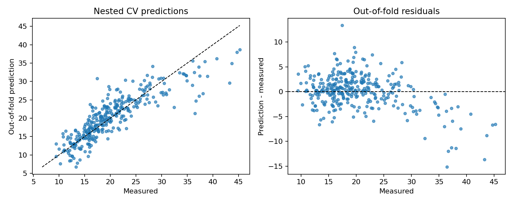
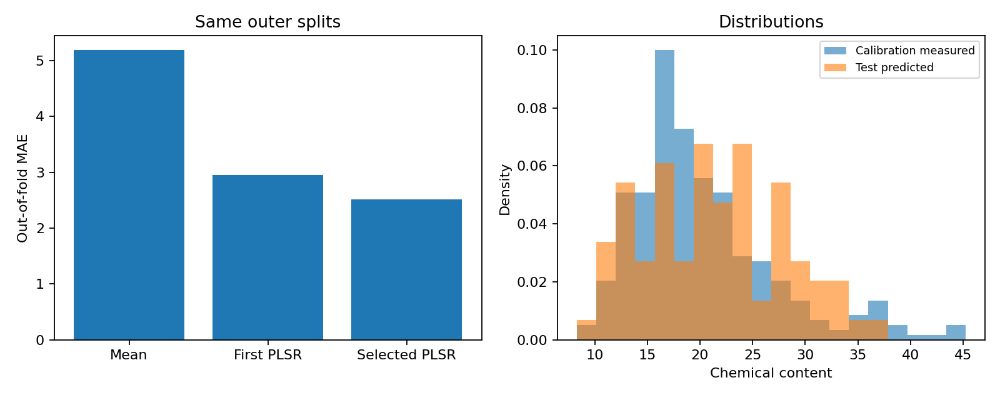

# 近红外定量模型优化评价报告

## 结论

在原来的 320 条校正数据、相同随机外层五折上，本版**嵌套选模的折外预测** SEP 为 **3.4672**、MAE 为 **2.5147**；首版分别为 3.8872、2.9463，训练折均值基线为 6.8504、5.1847。这不是独立测试精度，也无法据此证明已达到未给定的可用标准。成分名称、单位及验收阈值在数据说明中未提供。

## 数据、预处理与选模

校正集 320 条、测试集 80 条，每条光谱含 2074 个波数/吸光度点。按标注工作簿的光谱文件名匹配，检查文件集合、数值、点数与波数轴。测试集没有真值，没有用于选参或评价。

在运行本版前规定候选：全波段 PLS 回归搭配四种逐光谱处理——原始、SNV（每条光谱减自身均值再除自身标准差，`ddof=0`）、Savitzky–Golay 一阶导数（窗口 15 点、二阶多项式、默认插值边界、以点序为间隔），以及 SNV 后一阶导数。每种处理比较潜变量数 5、10、15、20、25、30，共 24 组；`PLSRegression(scale=True, max_iter=500)` 的中心化和缩放只在每个训练子集上拟合。逐光谱变换不学习其他样本的统计量。

保持首版外层 `KFold(5, shuffle=True, random_state=42)`：每次留出 64 条。每个外层训练集内采用 `KFold(4, shuffle=True, random_state=123)`，按合并内层折外 MAE 最小选出**处理方式和潜变量数**（精确并列按上述处理顺序、潜变量升序），仅用外层训练集拟合后预测外层留出样本。每条校正样本恰有一个折外预测。均值基线取对应外层训练集真值均值。最终模型用全部校正集、同一内层选模规则重新选择并拟合，选中 **snv / 15 个潜变量**。

## 折外结果

竞赛口径：`SEP = sqrt(sum((实际值 - 预测值)^2)/(n - 1))`，不扣偏差；`MAE = sum(abs(实际值 - 预测值))/n`。下表指标均从全部 320 条折外预测直接汇总；偏差为预测减实测。

| 方法 | SEP | MAE | 偏差 | R² |
|---|---:|---:|---:|---:|
| 训练折均值基线 | 6.8504 | 5.1847 | 0.0000 | -0.0131 |
| 首版 PLSR | 3.8872 | 2.9463 | -0.1108 | 0.6738 |
| 本版嵌套选模 | 3.4672 | 2.5147 | 0.1042 | 0.7405 |

| 外层折 | 内层选中处理 | 潜变量数 | 折 SEP | 折 MAE |
|---|---|---:|---:|---:|
| 1 | snv | 15 | 3.5988 | 2.5716 |
| 2 | snv | 15 | 3.0999 | 2.5106 |
| 3 | snv | 15 | 2.9832 | 2.1526 |
| 4 | snv | 15 | 3.8336 | 2.6987 |
| 5 | snv | 15 | 3.8360 | 2.6401 |

图 1：左侧是折外实测与预测，虚线为理想值；右侧为预测减实测。实测不低于 30 的 30 条样本折外平均残差 -5.5663、MAE 5.5987；该分组是事后描述，不作为选参依据。

图 2：左侧为同一外层划分的 MAE 对比；右侧比较校正实测与测试预测的归一化密度，测试预测分布不等于测试真值分布。

## 对比不确定性及局限

- 本版相对首版的折外 MAE 变化（首版减本版）为 0.4316，SEP 变化为 0.4199。对 320 对固定折外预测做 2000 次样本级配对 bootstrap（种子 2026），变化的 95% 百分位区间分别为 MAE [0.2272, 0.6579]、SEP [0.1994, 0.6617]；正数表示本版误差更低。
- 这些区间仅描述固定折外预测的样本重抽样波动，不包含重新训练、拆分、候选设计和模型选择的不确定性；样本间可能相关，区间不能作为独立样本显著性证明。首版外层结果已被观察并用于发起本次优化，因此两版比较是探索性结果，而非全新独立确认。
- 不知道来源、批次和重复测量的分组；随机拆分可能泄露相关样本结构并高估泛化。需要获取分组元数据并进行组外验证，最好以独立批次或新仪器样本外部验证，明确可接受误差后才能判定实际可用性。
- 本版候选集有限，未评估更广泛方法；不要利用本次外层结果反复调整模型并声称其仍为无偏最终评价。所有学习型步骤必须放在训练折内；需要新的独立数据确认进一步选择。

## 测试预测与复现

[80 条逐文件预测](results_v2/test_predictions.csv) 的范围为 8.3080–37.5953；校正真值范围 9.4100–45.2400，其中 1 条预测超出此范围。即使预测在范围内，也不能证明样本位于光谱训练分布内。测试无真值，不计算其 SEP 或 MAE。折外结果和各候选内层分数分别见 [折外预测](results_v2/oof_predictions.csv)、[选模记录](results_v2/inner_scores.json)。

`python -m pip install -r requirements.txt` 后在仓库根运行 `python model_v2.py`；首版结果需保留在 `results/` 供同折对比，缺失时先运行 `python model.py`。本次环境 Python 3.11.0、NumPy 1.26.4、SciPy 1.17.1、scikit-learn 1.5.2。详细约定见 [Agent.md](Agent.md)。joblib 仅加载可信来源文件。
