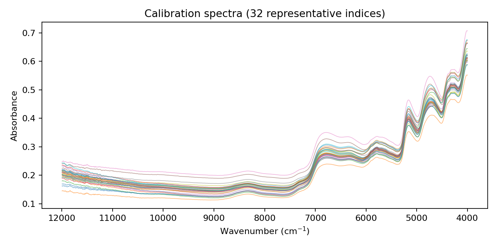
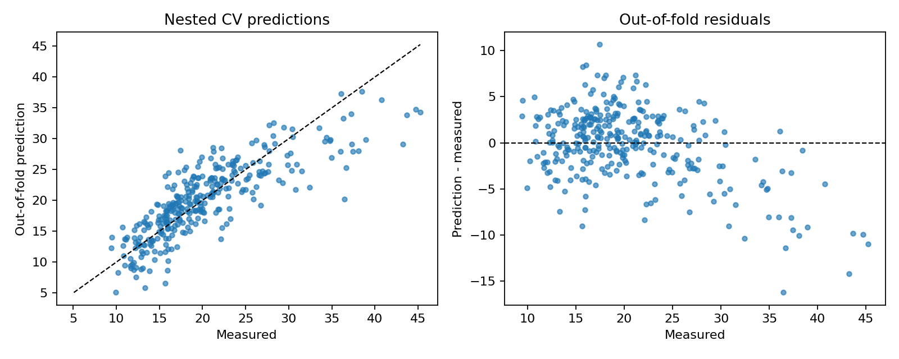
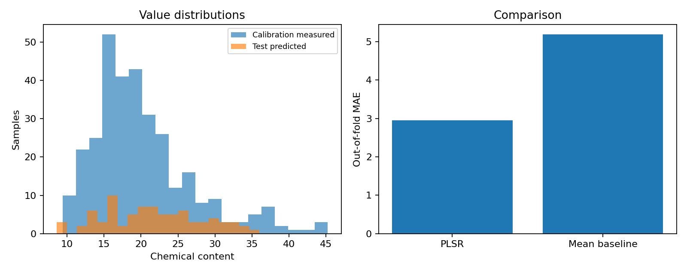

# 近红外化学成分定量：首个 PLSR 模型评价报告

## 结论与适用范围

320 条校正样本的五折**嵌套交叉验证折外预测**，PLSR 的 SEP 为 **3.8872**、MAE 为 **2.9463**；同期训练折均值基线分别为 6.8504、5.1847。这仅是现有校正样本随机拆分下的内部估计，不是独立测试集精度。化学成分名称及单位在原始说明中未给出，以下数值沿用原表尺度。

## 数据与方法

- 校正集 320 条，每条 2074 个波数/吸光度点；按工作簿“光谱名称”一一匹配，不使用序号推断对应关系。测试集 80 条，只有光谱、没有化学真值。读入时检查文件匹配、有限值、点数及所有波数轴一致性。
- 原始吸光度全波段输入 PLS 回归；`PLSRegression(scale=True)` 在每次拟合时仅用对应训练子集计算中心化和缩放。没有对全体数据预拟合预处理，也未用测试光谱参与选参。
- 外层五折 `KFold(shuffle=True, random_state=42)`：每次留出 64 条作为外层验证。每个外层训练集内部使用四折 `KFold(shuffle=True, random_state=123)`，在潜变量数 1–15 中按**合并内层折外 MAE 最小**选参；并列取较小值。外层模型仅用该外层训练集拟合，预测其留出折；每条样本恰有一次折外预测。
- 均值基线使用每个外层训练折的化学值均值预测其留出折；其指标与 PLSR 使用同一组外层拆分。
- 最终模型在完整 320 条校正数据上，以相同内层四折规则独立选参（15 个潜变量）并重新拟合；只用于 80 条测试光谱预测。

图 1：按原表顺序等间隔抽取 32 条校正光谱，仅用于展示；建模使用全部光谱。

## 指标与结果

按提供的竞赛口径，`SEP = sqrt(sum((实际值 - 预测值)^2) / (n - 1))`，不扣除偏差；`MAE = sum(abs(实际值 - 预测值)) / n`。汇总指标对全部 320 条折外预测直接计算，而非五折指标平均。偏差定义为预测值减实际值的均值；R² 是对全部折外预测计算的辅助指标。

| 方法 | 样本数 | SEP | MAE | 偏差 | R² |
|---|---:|---:|---:|---:|---:|
| 嵌套交叉验证 PLSR | 320 | 3.8872 | 2.9463 | -0.1108 | 0.6738 |
| 外层训练折均值基线 | 320 | 6.8504 | 5.1847 | 0.0000 | -0.0131 |

| 外层折 | 内层选定潜变量数 | 折 SEP | 折 MAE |
|---|---:|---:|---:|
| 1 | 15 | 4.0031 | 2.9325 |
| 2 | 15 | 3.8088 | 3.0389 |
| 3 | 14 | 3.2481 | 2.5533 |
| 4 | 14 | 4.0641 | 3.0673 |
| 5 | 13 | 4.3486 | 3.1396 |

图 2：左图为折外预测与实测的对应关系，虚线为理想值；右图为折外残差。偏离虚线或零线的点表示该随机拆分下的预测误差。
事后描述性诊断：实测值不低于 30 的 30 条样本中，平均残差为 -6.4850，MAE 为 6.6481，显示高值区域有低估倾向；该阈值并非预先设定，结论需要独立数据确认。

图 3：左图比较校正实测值与无标签测试集**预测值**的分布，不能解释为测试真值分布；两组样本量分别为 320 和 80，柱高为计数，不能直接比较比例。右图比较同拆分下折外 MAE。

## 测试集预测与局限

- [逐文件预测](results/test_predictions.csv) 含 80 个光谱文件名及预测值，预测范围 8.6211–35.9997；[折外逐样本结果](results/oof_predictions.csv) 可供追溯。预测是估计值，不是化验结果，也没有经过截断或四舍五入后再评估。
- 校正真值范围 9.4100–45.2400；测试预测中 3 条超出此范围。即使预测在该范围内，也不能证明光谱处于训练分布内。
- 缺少样本来源、批次或重复测量的分组信息；随机拆分可能将相关样本分到不同折，导致精度过于乐观，不能据此推断跨批次、跨仪器或未来样本表现。应取得分组元数据并采用分组外验证。
- 测试集无化学真值，无法计算其 SEP、MAE 或确认预测准确性；需独立化验后以相同口径评估。单次随机五折存在抽样不确定性；未提供置信区间或独立外部验证。
- 最终选出的 15 个潜变量位于候选上限 15；这提示更大的候选范围值得在未来独立设计的嵌套验证中探索，但不证明其更优。当前报告不基于外层结果反复扩大搜索范围。
- 当前仅探索原始光谱和潜变量数量，未比较预处理、异常值策略或其他模型；任何未来方案选择均须在外层训练数据内部完成，避免使用外层验证结果反复调参。

## 复现

在仓库根目录执行 `python -m pip install -r requirements.txt` 后运行 `python model.py`。产物包含本报告、图、折外预测、测试预测、指标 JSON 和最终模型。详细说明见 [Agent.md](Agent.md)。依赖已固定；Python 3.11.0、scikit-learn 1.5.2、NumPy 1.26.4 为本次运行版本。不同平台的数值库可能造成极小浮点差异。仅加载可信来源的 joblib 模型文件。
